# Leafwash

An English-language e-commerce storefront and admin dashboard for a plant-based cleaning brand, built with Next.js (App Router), React and TypeScript.

The project includes a public storefront, customer accounts, a cart with server-validated checkout, a blog, a contact form, and a role-protected admin dashboard. During local development the data layer is a `json-server` REST API backed by `db.json`.

> `json-server` is a demo data source. It is not a production database or an authorization boundary.

## Screenshots

### Storefront

| Home | Products |
| --- | --- |
| 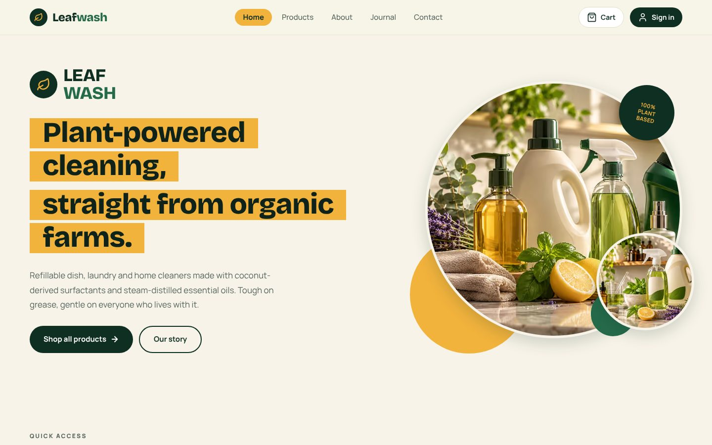 | 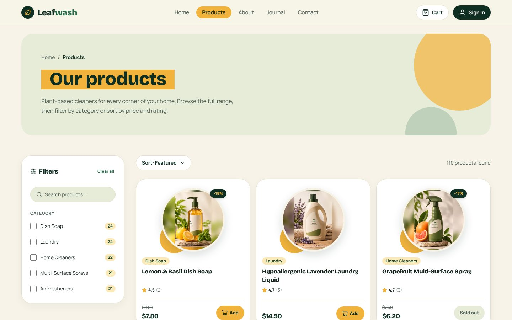 |

| Product details | Blog |
| --- | --- |
| 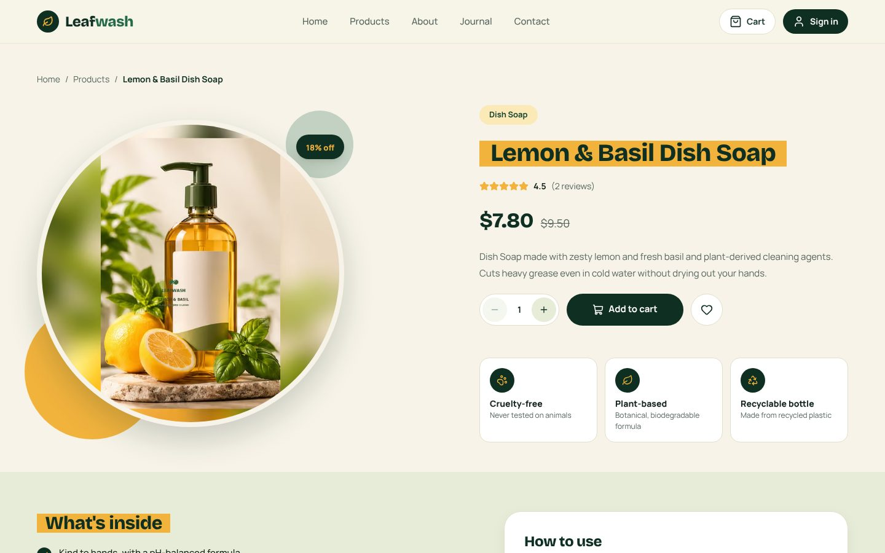 | 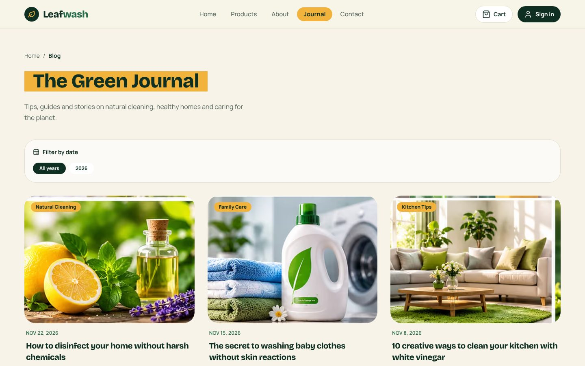 |

| About | Contact |
| --- | --- |
| 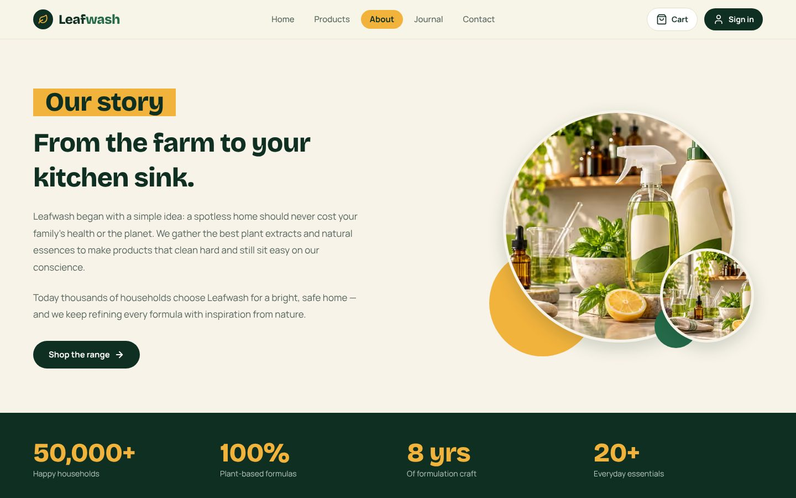 | 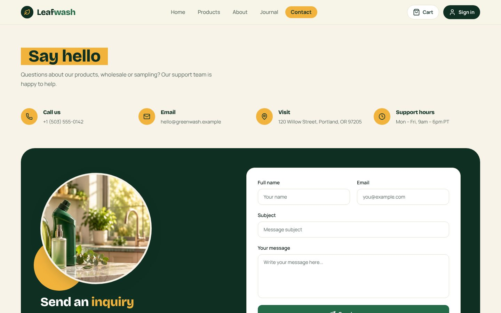 |

### Authentication

| Sign in | Create account |
| --- | --- |
| 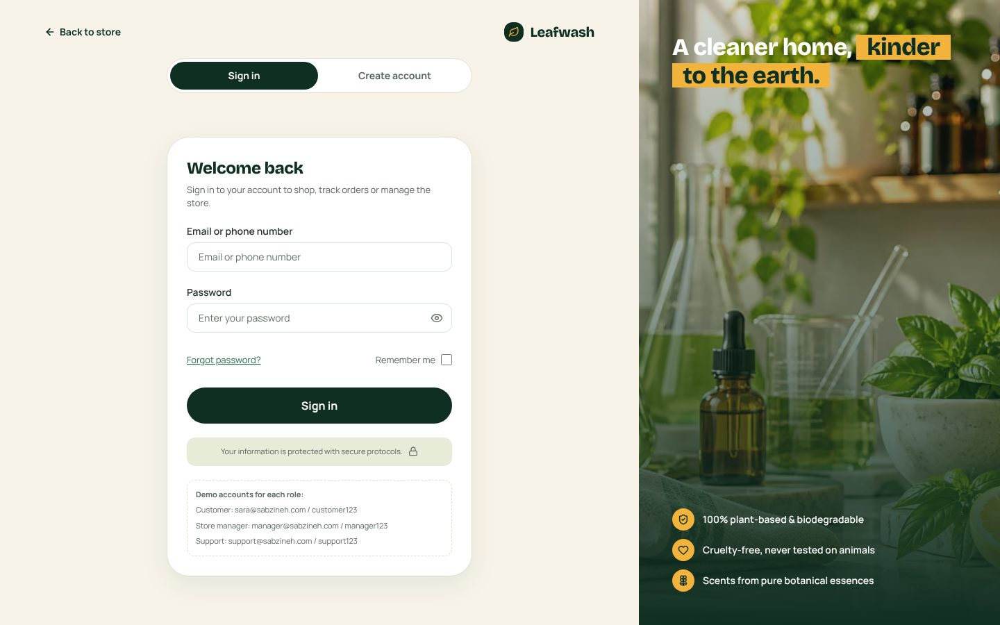 | 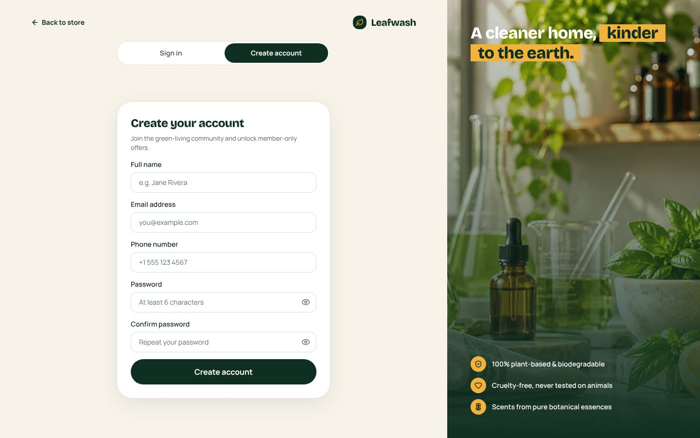 |

### Admin dashboard

| Overview | Products |
| --- | --- |
| 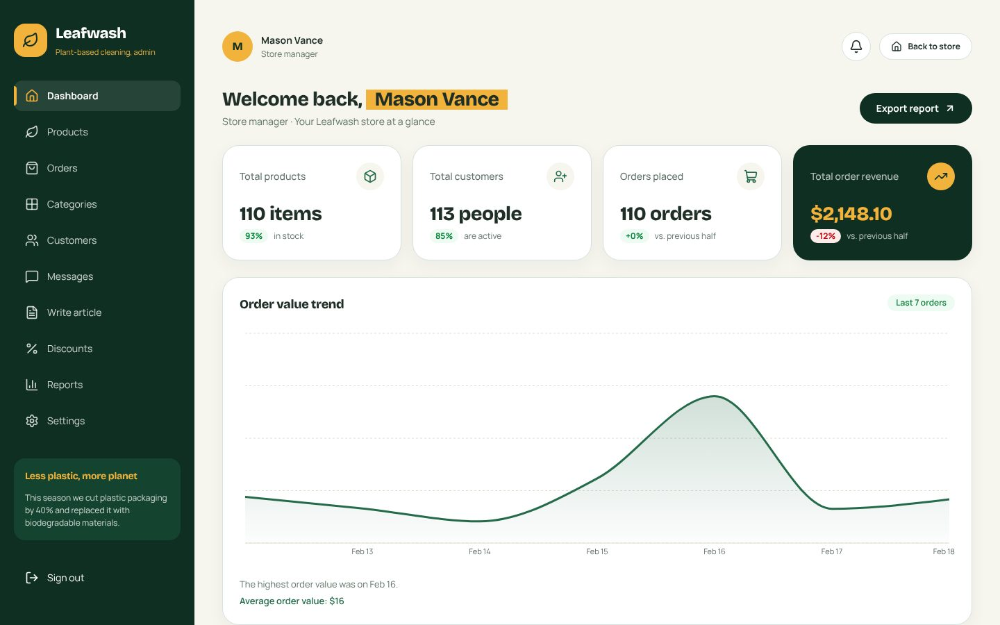 | 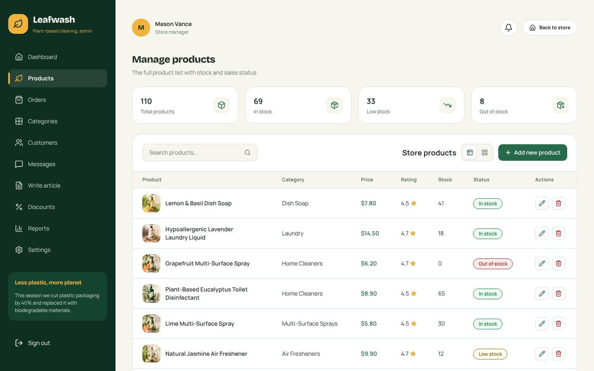 |

| Orders | Categories |
| --- | --- |
| 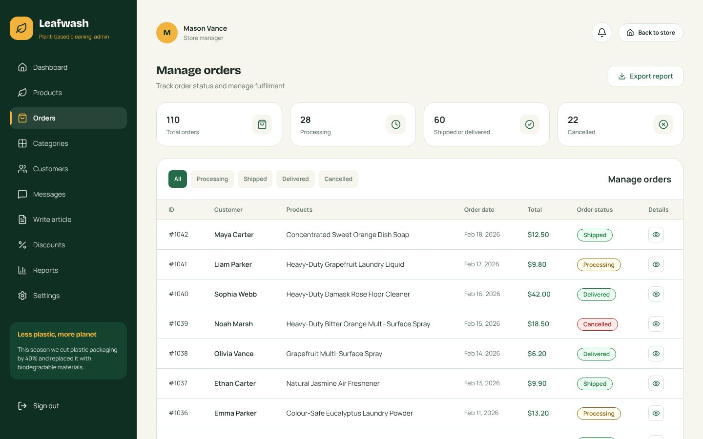 | 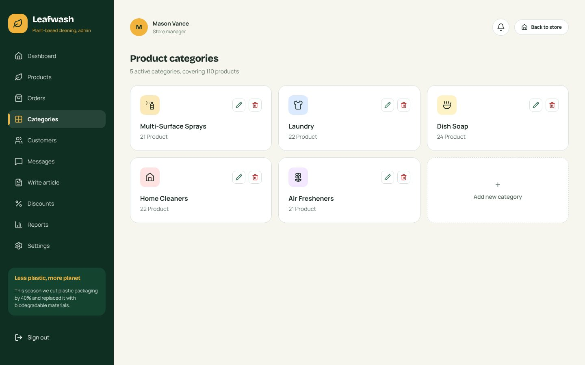 |

### Mobile

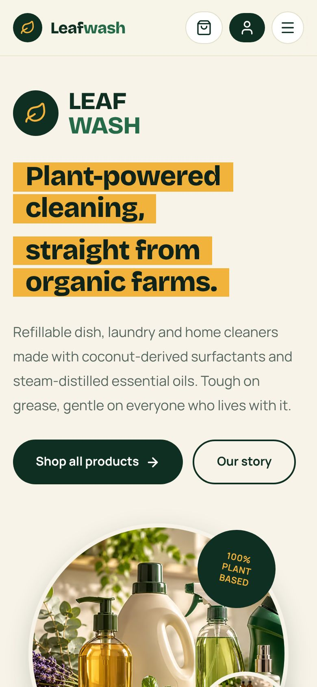

## Features

### Storefront

- Home page with hero, featured products, category showcase, ingredients, certificates, FAQ and newsletter signup
- Product listing with debounced search, category filters, sorting and pagination
- Product detail pages with image, highlights, usage notes, reviews and related products
- Cart drawer and cart page with quantity controls and stock limits, persisted in the browser
- Discount codes validated against the API
- Checkout for signed-in customers: prices, stock and discounts are recalculated on the server, the order is saved, and stock is reduced
- Wishlist stored on the customer account
- Blog with year and month archives and article pages
- About and contact pages, with contact messages saved for the dashboard
- SEO: metadata, Open Graph, JSON-LD, sitemap, robots and web manifest

### Accounts

- Sign up and sign in (email or phone number) with Auth.js credentials and JWT sessions
- Account page with profile editing, order history, wishlist and messages
- Roles: `customer`, `manager` and `support`
- `/dashboard` is limited to `manager` and `support`; `/account` is limited to customers

### Admin dashboard

- Overview with stats and charts, and a reports page
- Products: create, edit, delete, search, table and grid views, image upload
- Categories, orders (with details and export), customers, discounts and messages with replies
- Blog article creation
- Store settings (stored in the browser)

### Quality

- Responsive layout, checked at mobile, tablet and desktop widths
- Keyboard-accessible modals with focus trapping and Escape to close
- Loading, error and not-found states for every route group
- Toast notifications with Sonner

## Tech stack

| Technology | Purpose |
| --- | --- |
| Next.js 16, React 19 | App Router, server and client components |
| TypeScript | Static typing |
| Tailwind CSS 4 | Styling |
| TanStack Query | Server state and caching |
| React Hook Form, Zod | Forms and validation |
| Zustand | Persisted cart store |
| Auth.js (next-auth v5) | Authentication and sessions |
| bcryptjs | Password hashing |
| Framer Motion | Animations |
| Recharts | Dashboard charts |
| Swiper | Product carousels |
| Lucide React | Icons |
| Cloudinary | Product and article image uploads |
| json-server | Local demo REST API |

## Project structure

```text
src/
├── app/            Routes, layouts and API route handlers
│   └── api/        auth, signup, checkout, contact, upload, data proxy
├── components/     Shared UI, layout, motion and providers
├── features/       Domain modules (auth, products, cart, orders, customers,
│                   discounts, messages, dashboard, account, blog, about)
├── lib/            HTTP client, security helpers, storage, SEO, utilities
├── types/          Shared type declarations
├── auth.ts         Auth.js configuration
└── proxy.ts        Route protection for /dashboard and /account
```

The browser never talks to `json-server` directly. Requests go through `/api/data/*`, which checks the session and the user's role before forwarding the request, and removes password hashes from customer responses.

## Getting started

Requirements: Node.js 20 or newer.

```bash
npm install
cp .env.example .env.local
```

Set `AUTH_SECRET` in `.env.local` (generate one with `openssl rand -base64 32`), then start the API and the app together:

```bash
npm run dev:all
```

Or run them separately:

```bash
npm run api    # json-server on http://localhost:4000
npm run dev    # Next.js on http://localhost:3000
```

Create a customer account from `/auth`. Staff accounts exist in `db.json` with hashed passwords; to sign in as staff, replace a staff user's `password` with a bcrypt hash of a password you choose.

> `json-server` writes changes (orders, accounts, stock) back to `db.json`. Reset the file with Git if you want to restore the demo data.

## Environment variables

| Variable | Required | Description |
| --- | --- | --- |
| `API_URL` | Yes | Base URL of the REST API (`http://localhost:4000` for the demo) |
| `AUTH_SECRET` | Yes in production | Secret used to sign Auth.js sessions |
| `AUTH_TRUST_HOST` | Optional | Set to `true` behind a proxy or on a custom host |
| `NEXT_PUBLIC_SITE_URL` | Recommended | Public URL used for canonical links, sitemap and Open Graph |
| `CLOUDINARY_CLOUD_NAME` | For uploads | Cloudinary cloud name |
| `CLOUDINARY_UPLOAD_PRESET` | For uploads | Unsigned upload preset |

Image uploads are disabled until both Cloudinary variables are set. `.env.local` is ignored by Git; never commit real secrets.

## Scripts

| Command | Description |
| --- | --- |
| `npm run dev` | Start the Next.js development server |
| `npm run api` | Start the demo API on port 4000 |
| `npm run dev:all` | Start both together |
| `npm run build` | Create a production build |
| `npm start` | Run the production build |
| `npm run lint` | Run ESLint |
| `npm run typecheck` | Run the TypeScript compiler without emitting files |
| `npm run format` | Format `src` with Prettier |

## Routes

| Route | Purpose |
| --- | --- |
| `/` | Home |
| `/products`, `/products/[id]` | Product listing and details |
| `/cart` | Cart and checkout |
| `/auth` | Sign in and sign up |
| `/account` | Customer account |
| `/blog`, `/blog/[year]`, `/blog/[year]/[month]`, `/blog/article/[id]` | Blog and archives |
| `/about`, `/contact` | Information pages |
| `/dashboard` | Admin overview |
| `/dashboard/products`, `/categories`, `/orders`, `/users`, `/discounts`, `/messages`, `/reports`, `/settings`, `/blog/create` | Admin sections |

## Security notes

- Dashboard routes and data endpoints are authorized by role on the server.
- Checkout, discount and stock logic run on the server; the client only sends product IDs and quantities.
- Uploaded images are validated by size and file signature before being sent to Cloudinary.
- Passwords are hashed with bcrypt.

Before a real deployment, replace `json-server` with a proper backend and database, store secrets in your platform's secret manager, and review authorization, rate limiting and logging on that backend.

## Author

**Mohamadreza Obaidi**  
Frontend Developer: React, Next.js, TypeScript

## License

This repository is a personal portfolio project. Educational use and code study are welcome; re-publishing the complete project as your own work is not permitted without the author's permission.
